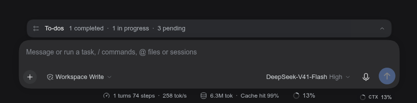
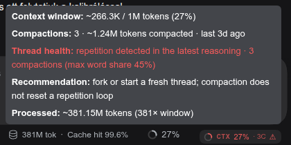

# dsh-context-health-badge

An always-visible **context-window and thread-health badge** in the DeepSeek
Harness Web GUI conversation's bottom-right corner. The raw percentage says how
full the context is; the badge also says how much longer the thread is actually
usable.

English · [Magyar](#magyar)



```
CTX 27% · 3C ⚠
```

- `27%` — the next request's expected prompt size against the route's context window.
- `3C` — compactions found in the whole session log (host-side projection).
- `⚠` — the latest assistant reasoning looks repetitive.


The example above is an archived thread with three compactions: the raw context
is only **27%**, yet the badge is red because the history was rewritten three
times and the reasoning repeats. The raw `%` alone would say "plenty of room
left" — which is exactly why it is not enough.



## The hover panel

The panel follows the DSH tooltip look (dark bubble, 13 px, portalled), but with
React content: it opens immediately, right-aligns above the badge, bolds the row
prefixes, adds 5 px between rows, and tints the dangerous `Thread health:` row
with the amber/red state colour. It is keyboard reachable (Tab) and opens on
focus too.

```
Context window: ~266.3K / 1M tokens (27%)
Compactions: 3 · ~1.24M tokens compacted · last 3d ago
Thread health: repetition detected in the latest reasoning · 3 compactions (max word share 45%)
Recommendation: fork or start a fresh thread; compaction does not reset a repetition loop
Processed: ~381.15M tokens (381× window)
```

## Thresholds

### Context-window pressure

| Percent | Look | Meaning |
|---|---|---|
| 0–69 % | neutral | a larger request fits comfortably |
| 70–89 % | amber | watch out, the limit is close |
| 90–100 % | red | the next request may not fit |

### Thread health

| Signal | Colour | When |
|---|---|---|
| 2 compactions | amber | the thread was summarised twice |
| 3+ compactions | red | the history was rewritten repeatedly; a new thread is advised |
| repetition ≥ 32 % | amber | "possible repetition" in the latest reasoning |
| repetition ≥ 45 % | red | a clear repetition loop; compaction does not heal it |

The repetition score is the largest share of one word inside a sliding 100-word
window. Normal English prose keeps its most frequent word (e.g. "the") around
5–8 %; degenerate reasoning climbs past 30–50 %. The detector is
language-agnostic: it assumes word boundaries, not an English vocabulary.

## Why the raw percentage is not enough

Measured on an archived, 1M-window thread:

| Time | Event | Prompt |
|---|---|---|
| 10-17 23:04 | compaction #1 | 403k tokens shadowed |
| 10-18 04:00 | compaction #2 | 425k tokens shadowed |
| 10-18 04:02:52 | first strong repetition | **~176k = 17.6 %** |
| 10-18 13:44–14:38 | sustained degradation | 519k–647k = 52–65 % |
| 10-18 15:36 | compaction #3 | 410k tokens shadowed |
| 10-18 15:36:51 | repetition after the compaction | ~171k |

The thread did not max out at 98 %. The first strong signal came at 17.6 %, and
the third compaction brought the context back to ~171k while the repetition
**stayed**. Compaction frees room; it does not repair a stuck model. If the badge
shows `⚠`, the right move is a fork or a fresh thread, not another `/compact`.

## How it works

| File | Role |
|---|---|
| `index.js` | host half: registers the `contextHealthBadge` Session projection — one fold over the complete durable log (compaction count, shadowed tokens, last compaction time, repetition score) |
| `client.js` | browser half: the badge in `conversation.composer.dock`, the portal tooltip, keyboard focus |
| `cordis.patch.yml` | the bundle layer that inserts the `context-health-badge` row |
| `test/client.test.mjs` | dependency-free tests for both halves |

The browser cannot see compactions outside its loaded Chat window, so the host
projects them: the fold is driven eagerly by the session-projection registry, so
history replay and live events share one implementation. The badge reads that
projection through the standard `useProjection` prop every `session`-scoped slot
receives.

## Install

From the Web GUI: **Plugins → Add plugin**, enter this checkout's path or the
repository URL, then **Install → Enable now → F5**.

```sh
dsh plugin --profile web add /path/to/dsh-context-health-badge
# or a git address once published:
dsh plugin --profile web add git+https://github.com/meszaros-lajos-gyorgy/dsh-context-health-badge.git
```

Remove it with **Plugins → disable/remove**. A client-half change lands on the
next page load; a host-half change needs a DSH restart when HMR watches
configuration only.

## Tests

```sh
node test/client.test.mjs
```

Covers the repetition detector, the occupancy reading, the badge/tooltip rows,
the tone thresholds, the projection fold and the slot registration.

## Limitations

- The badge lives in the composer dock: it is mounted in a session view, not on
  the hero/New Session screen.
- The projection follows the session log; a compaction that happened before the
  plugin was enabled is still counted (the fold starts from the beginning).
- Repetition is measured on Assistant reasoning (falling back to the answer); a
  tool-heavy turn without reasoning text reads as healthy.
- A host restart starts the projection from the log again — no state is lost,
  only recomputed.

## License

MIT — see [LICENSE](LICENSE).

## Magyar

**Context-window + thread-health badge** a Web GUI beszélgetés jobb alsó
sarkában, a composer alatt.

- `CTX 27% · 3C ⚠` — a következő kérés várható prompt-mérete, a teljes logban
  talált compactionök száma, és hogy az utolsó reasoning ismétlődik-e.
- A hover-panel kiírja a token-keretet, a compactionöket (shadowed tokenekkel,
  utolsó időponttal), a health-ítéletet, egy javaslatot és a feldolgozott
  tokenek számát.
- **Küszöbök**: context 70% borostyán / 90% piros; 2 compaction borostyán, 3+
  piros; repetition 32% borostyán, 45% piros.
- **Miért nem elég a %?** Egy archivált, 1M-es threadnél az első erős ismétlődés
  17,6%-nál jött, a harmadik compaction után pedig a repetition megmaradt — a
  compaction helyet szabadít, nem gyógyítja a beragadt modellt. Ha `⚠` van, a
  helyes lépés a fork / új thread.
- **Telepítés**: Plugins → Add plugin (mappa vagy git cím), majd F5.
- A compaction-számot a **host** projekció adja (`contextHealthBadge`), mert a
  böngésző csak a betöltött Chat-ablakot látja.
- Teszt: `node test/client.test.mjs`.
